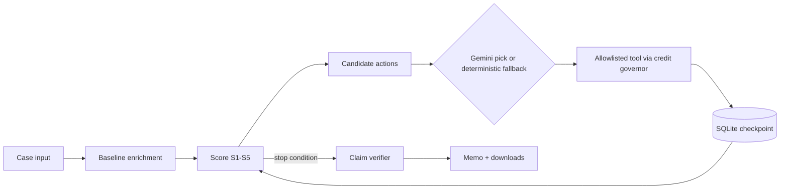

# DealScope

[](https://github.com/khasim007q/DealScope/actions/workflows/ci.yml)

Evidence-led, outside-in organizational diligence agent for PE, growth-equity and corp-dev teams.
It surfaces externally observable organizational signals that could undermine a deal thesis, shows the evidence
behind each one, and turns them into a sourced list of questions to validate before signing.

**DealScope is not** an investment recommendation, valuation tool or legal opinion. It does not compute true employee
attrition (public profiles are a sample, not a census), does not make causal or misconduct allegations from job moves,
and treats missing data as "not enough data", never as reassurance. Fixture runs show a `SYNTHETIC DEMO DATA` banner.

## How the agent works

A case (target domain, 0-5 optional competitor domains, an optional deal thesis, lookback) first builds a baseline:
company enrichment for the target and any competitors from the configured data source (Crustdata, or People Data
Labs in free mode; a source that is not configured is skipped and the case still completes with limited coverage).
Deterministic code then scores five signals (S1-S5) and enumerates the *candidate* next
actions that are legal right now (allowlisted tool, registered domain, not already done, affordable). Gemini may pick
exactly one candidate and explain why; with no `LLM_API_KEY`, or if its answer is invalid, a deterministic policy picks.
The chosen tool runs through the credit governor (reserve before the call, settle after), the result is checkpointed to
SQLite, signals are rescored, and the loop repeats until coverage is sufficient, a cap is hit, or no action would change a
conclusion. Draft findings (template or LLM) must pass the deterministic claim verifier, which rejects uncited,
causal or over-generalised claims, before anything reaches the memo. Failed runs can be resumed without replaying
completed metered calls.

For a guided summary of how the agent works and the tradeoffs, see [docs/walkthrough.md](docs/walkthrough.md)
(also in the app under **How it works**).

## Quickstart

Requires Python 3.12, [uv](https://docs.astral.sh/uv/) and Node.js 20+.

```
uv venv --python 3.12 .venv
uv pip install --python .venv -e ".[dev]"
cp .env.example .env            # Windows: copy .env.example .env
npm --prefix frontend install
npm --prefix frontend run build # builds the React + TypeScript UI into frontend/dist
.venv/Scripts/uvicorn dealscope.api.server:app --port 8000   # macOS/Linux: .venv/bin/uvicorn ...
```

Open http://localhost:8000. The FastAPI server (`src/dealscope/api/server.py`) serves the UI and the JSON API;
investigations run in background threads and the UI polls for progress. For UI development run
`npm --prefix frontend run dev` (http://localhost:5173, proxies `/api` to port 8000).

Tests and lint: `python -m pytest -q`, `ruff check .`, and `npm --prefix frontend run typecheck`.

| Mode | Keys needed |
|---|---|
| Synthetic fixture | none |
| Live, free (default, `DATA_PROVIDER=free`) | none for job postings; `PDL_API_KEY` (free) adds company and people data |
| Live, paid (`DATA_PROVIDER=crustdata`) | `CRUSTDATA_API_KEY` |
| LLM planner/synthesis (optional) | `LLM_API_KEY` (Gemini); without it the deterministic planner runs |
| Tracing | none; the agent's OpenTelemetry spans are recorded locally to SQLite |

Live mode never falls back to fixtures. Put secrets only in `.env` (never commit it).

### Free data mode (`DATA_PROVIDER=free`, the default)

Live runs cost 0 Crustdata credits. Job postings come from the public, keyless job-board APIs of Greenhouse, Lever and
Ashby (board slug derived from the company domain). Company profiles and people come from
[People Data Labs](https://www.peopledatalabs.com) (free signup, about 100 records per month; set `PDL_API_KEY`, and
`PDL_MONTHLY_LIMIT` is a local guard on that quota, `PDL_MAX_RECORDS_PER_CASE` (default 30) caps one case). Company
lookups are cached on disk, so the identity check and the run that follows cost one record, and resuming a case does
not re-spend PDL records. A damaged usage file pauses PDL lookups (fail closed) rather than allowing unlimited use.

A job board is matched to the company by slug, which ignores the TLD, so each board is cross-checked: job links on the
company's own domain confirm it, links on another company's domain reject it, and anything else is kept but labelled
"matched by name only" (lower confidence, shown in the answer's coverage note). A resume is refused if
`DATA_PROVIDER` changed since the case was created.

What each signal needs:

- **S4 critical-role hiring pressure**: works from job boards alone, if the company uses one of the three ATSs.
- **S1 technical-function trajectory**: needs role-level headcount history, which only PDL company data can provide.
- **S2 role continuity, S3 capability coverage, S5 competitor movement**: need people and departures, so PDL.
- Without a PDL key those signals come out "not scored", coverage drops, and a low-coverage case honestly reports
  INSUFFICIENT EVIDENCE rather than a risk number. Without a PDL key the website check is also skipped (shown as
  "Not verified").

Set `DATA_PROVIDER=crustdata` to use the paid Crustdata source instead (requires `CRUSTDATA_API_KEY`).

## Architecture

| Module (`src/dealscope/`) | Role |
|---|---|
| `api/server.py` | FastAPI: case lifecycle, background runs, free identity check, downloads, serves the UI |
| `api/views.py` | Translates internal state (reason codes, stages, outcomes) into plain-language view models |
| `analysis/data_quality.py` | Drops implausible provider growth values before scoring and flags them |
| `../../frontend/` | React + TypeScript UI (Vite): search-first Home (type a company, optional competitors and thesis), case detail (with Stop/Resume), cases, compare, evidence, how it works |
| `api/evidence.py` | Evidence page data: Crustdata pricing and credit usage from committed files |
| `persistence/featured.py` | Local-only featured (recorded) live cases for credit-free demos (gitignored) |
| `agent/planner.py` | Enumerates legal candidate actions; LLM picks one or deterministic policy decides |
| `agent/orchestrator.py` | Bounded investigate / recover / stop loop; checkpoints every stage and tool result |
| `agent/tools.py` | Allowlisted tools; schema + domain checks, idempotency, cache, credit reservation, retry |
| `agent/synthesis.py` | LLM drafting of cited findings (baseline and improved prompt variants) |
| `analysis/signals.py` | Deterministic S1-S5 scoring, composite scorecard, risk vs confidence vs coverage |
| `analysis/peer_benchmark.py` | Pure peer-benchmark helpers (median/quartiles, weak-benchmark flags) |
| `budget/governor.py` | Persisted, fail-closed credit accounting (reserve, settle, unknown-outcome) |
| `persistence/repository.py` | SQLite (WAL) state, evidence, ledger; durable at each tool-result boundary |
| `providers/crustdata.py` | Live Crustdata client (API 2025-11-01) and normalization |
| `providers/fixture.py` | Synthetic data source with the same interface and fault injection |
| `providers/http_retry.py` | Bounded retry (429/5xx, connect failures); unknown-outcome calls never replayed |
| `providers/classify.py` | Deterministic job-title classifier and query vocabularies |
| `providers/llm.py` | Configurable LLM adapter (Gemini); output treated as untrusted |
| `verification/claims.py` | Deterministic claim verifier gating the memo |
| `reports/memo.py` | Memo renderer and JSON evidence bundle (verified claims only) |
| `observability/tracing.py` | OpenTelemetry instrumentation with redacted attributes |
| `observability/recorder.py` | Records each run's spans per case into SQLite for the trace waterfall on the case page |



## Credit policy

(Applies to `DATA_PROVIDER=crustdata`. Free-source runs are priced at 0 credits and show "Free data sources".)

Crustdata budget is configured from the real account balance. Our account has 200 credits, so `.env.example` sets
200 total, a 40-credit global reserve (never spent) and a 40-credit per-case cap (spec defaults were 5,000 / 1,000 / 300).
Documented prices (docs/10 section 7): company enrich 2 per matched record; person search about 0.23 per result with
employment history filtered and returned; jobs search 0.03 per result per docs, but live jobs stay **disabled
(fail closed)** until the price is confirmed from account pricing and configured via `CRUSTDATA_JOB_COST_PER_RESULT`.
Unknown prices block the call. Fixture runs use a separate simulated ledger pool and never touch the live budget.
Figures in the UI are estimates unless marked actual.

## Safety and limits

- Access control: the server binds to 127.0.0.1 by default. Routes that start work or spend quota
  (`POST /api/cases`, `/resume`, `/cancel`, `/identity-check`) accept loopback clients only. To expose the server
  (another machine, a reverse proxy, a container) set `DEALSCOPE_API_TOKEN`; every client must then send it in the
  `X-DealScope-Token` header (the web UI asks for it once and remembers it in the browser). Requests whose `Host` is
  not in `DEALSCOPE_TRUSTED_HOSTS` (default `localhost,127.0.0.1,[::1]`) are rejected, which blocks DNS rebinding;
  add your public host name there when you deploy, or use `*` to turn the check off. Behind a reverse proxy on the same host every
  client looks like loopback, so the loopback-only rule protects nothing there: when you deploy behind a proxy or on a
  network you must set both `DEALSCOPE_API_TOKEN` and `DEALSCOPE_TRUSTED_HOSTS`. Browser requests carrying a
  cross-site `Sec-Fetch-Site` or an `Origin` outside the trusted hosts (any port) are refused on those routes. Identity checks are capped at 6 domains per request
  and 30 per minute per client.
- One worker per case: a second resume while a case is running gets HTTP 409, also across server processes (a
  60-second database lease with a heartbeat; a crashed worker's lease expires on its own).
- Run failures are never silent: if a run cannot start or crashes, the case ends as Failed with a plain error note,
  and `/api/status` reports an unsupported `LLM_PROVIDER`.
- A case whose evidence is too thin for an overall score is labelled "limited evidence"; it is Partial (resumable)
  when a skipped data source, such as a missing key, could add more, and Complete otherwise.
- Per run: 8 planner turns, 12 tool calls, 240 s, 2 retries (configurable in `.env`).
- Risk, evidence confidence and coverage are reported separately; low coverage is never shown as low risk.
- No attrition rates, causal or misconduct allegations, or valuation/buy-pass advice.
- No contact data requested; raw provider JSON is hashed, not stored; recorded traces carry redacted attributes only (model prompt/response text is dropped).

## Observability

Every run emits OpenTelemetry spans for planning, each tool call, retries, scoring, the verifier and the memo. They are
recorded per case into the local SQLite database (`src/dealscope/observability/recorder.py`) and shown as a trace
waterfall on the case page. There is no tracing service and no tracing API key.

## CLI runner

`scripts/run_case.py` runs cases without the UI (synthetic fixture runs, live runs, a failure/resume drill and a
baseline-versus-improved prompt comparison; see `python scripts/run_case.py --help`). Results are written to
`reports/runs/` (gitignored).

## Evidence page

The **Evidence** page in the app shows the Crustdata pricing and credit usage behind the credit policy, read from
[`evidence/crustdata/`](evidence/crustdata/) (account pricing check and a single-company smoke test).

Walkthrough: [`docs/walkthrough.md`](docs/walkthrough.md).
