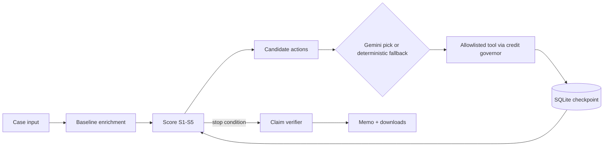

# DealScope

Evidence-led, outside-in organizational diligence agent for PE, growth-equity and corp-dev teams (neatHack MVP).
It surfaces externally observable organizational signals that could undermine a deal thesis, shows the evidence
behind each one, and turns them into a sourced list of questions to validate before signing.

**DealScope is not** an investment recommendation, valuation tool or legal opinion. It does not compute true employee
attrition (public profiles are a sample, not a census), does not make causal or misconduct allegations from job moves,
and treats missing data as "not enough data", never as reassurance. Fixture runs show a `SYNTHETIC DEMO DATA` banner.

## How the agent works

A case (target domain, 2-5 peer domains, deal thesis, lookback) first builds a baseline: Crustdata company enrichment
for the target and peers. Deterministic code then scores five signals (S1-S5) and enumerates the *candidate* next
actions that are legal right now (allowlisted tool, registered domain, not already done, affordable). Gemini may pick
exactly one candidate and explain why; with no `LLM_API_KEY`, or if its answer is invalid, a deterministic policy picks.
The chosen tool runs through the credit governor (reserve before the call, settle after), the result is checkpointed to
SQLite, signals are rescored, and the loop repeats until coverage is sufficient, a cap is hit, or no action would change a
conclusion. Draft findings (template or LLM) must pass the deterministic claim verifier, which rejects uncited,
causal or over-generalised claims, before anything reaches the memo. Failed runs can be resumed without replaying
completed metered calls.

For a guided summary of how the agent works, the tradeoffs and what neatlogs, Entire and cfo.ai changed, see
[docs/walkthrough.md](docs/walkthrough.md) (also in the app under **How it works**).

## Quickstart

Requires Python 3.12, [uv](https://docs.astral.sh/uv/) and Node.js 20+.

```
uv venv --python 3.12 .venv
uv pip install --python .venv -e ".[dev]"
cp .env.example .env            # Windows: copy .env.example .env
npm --prefix frontend install
npm --prefix frontend run build # builds the React + TypeScript UI into frontend/dist
.venv/Scripts/uvicorn dealscope.api.server:app --port 8000   # macOS/Linux: .venv/bin/uvicorn ...
```

Open http://localhost:8000. The FastAPI server (`src/dealscope/api/server.py`) serves the UI and the JSON API;
investigations run in background threads and the UI polls for progress. For UI development run
`npm --prefix frontend run dev` (http://localhost:5173, proxies `/api` to port 8000).

Tests and lint: `python -m pytest -q`, `ruff check .`, and `npm --prefix frontend run typecheck`.

| Mode | Keys needed |
|---|---|
| Synthetic fixture | none |
| Live Crustdata | `CRUSTDATA_API_KEY` |
| LLM planner/synthesis (optional) | `LLM_API_KEY` (Gemini); without it the deterministic planner runs |
| Traces | `NEATLOGS_API_KEY`; without it tracing is a no-op and the UI says "not connected" |

Live mode never falls back to fixtures. Put secrets only in `.env` (never commit it).

## Architecture

| Module (`src/dealscope/`) | Role |
|---|---|
| `api/server.py` | FastAPI: case lifecycle, background runs, free identity check, downloads, serves the UI |
| `api/views.py` | Translates internal state (reason codes, stages, outcomes) into plain-language view models |
| `analysis/data_quality.py` | Drops implausible provider growth values before scoring and flags them |
| `../../frontend/` | React + TypeScript UI (Vite): new investigation, case detail, cases, how it works |
| `agent/planner.py` | Enumerates legal candidate actions; LLM picks one or deterministic policy decides |
| `agent/orchestrator.py` | Bounded investigate / recover / stop loop; checkpoints every stage and tool result |
| `agent/tools.py` | Allowlisted tools; schema + domain checks, idempotency, cache, credit reservation, retry |
| `agent/synthesis.py` | LLM drafting of cited findings (baseline and improved prompt variants) |
| `analysis/signals.py` | Deterministic S1-S5 scoring, composite scorecard, risk vs confidence vs coverage |
| `analysis/peer_benchmark.py` | Pure peer-benchmark helpers (median/quartiles, weak-benchmark flags) |
| `budget/governor.py` | Persisted, fail-closed credit accounting (reserve, settle, unknown-outcome) |
| `persistence/repository.py` | SQLite (WAL) state, evidence, ledger; durable at each tool-result boundary |
| `providers/crustdata.py` | Live Crustdata client (API 2025-11-01) and normalization |
| `providers/fixture.py` | Synthetic data source with the same interface and fault injection |
| `providers/http_retry.py` | Bounded retry (429/5xx, connect failures); unknown-outcome calls never replayed |
| `providers/classify.py` | Deterministic job-title classifier and query vocabularies |
| `providers/llm.py` | Configurable LLM adapter (Gemini); output treated as untrusted |
| `verification/claims.py` | Deterministic claim verifier gating the memo |
| `reports/memo.py` | Memo renderer and JSON evidence bundle (verified claims only) |
| `observability/tracing.py` | neatlogs facade with safe attributes; no-op without a key |



## Credit policy

Crustdata budget is configured from the real account balance. Our account has 200 credits, so `.env.example` sets
200 total, a 40-credit global reserve (never spent) and a 40-credit per-case cap (spec defaults were 5,000 / 1,000 / 300).
Documented prices (docs/10 section 7): company enrich 2 per matched record; person search about 0.23 per result with
employment history filtered and returned; jobs search 0.03 per result per docs, but live jobs stay **disabled
(fail closed)** until the price is confirmed from account pricing and configured via `CRUSTDATA_JOB_COST_PER_RESULT`.
Unknown prices block the call. Fixture runs use a separate simulated ledger pool and never touch the live budget.
Figures in the UI are estimates unless marked actual.

## Safety and limits

- Per run: 8 planner turns, 12 tool calls, 240 s, 2 retries (configurable in `.env`).
- Risk, evidence confidence and coverage are reported separately; low coverage is never shown as low risk.
- No attrition rates, causal or misconduct allegations, or valuation/buy-pass advice.
- No contact data requested; raw provider JSON is hashed, not stored; traces carry redacted attributes only.

## Partner tools

- **neatlogs** (runtime observability): traces plans, tool calls, retries, scores and verifier decisions. Proof pending:
  [`evidence/neatlogs/`](evidence/neatlogs/successful-run.md) templates are not yet filled with real trace IDs.
- **Entire** (dev workflow): checkpoints linking Claude Code sessions to commits. Proof pending:
  [`evidence/entire/README.md`](evidence/entire/README.md).
- **cfo.ai** (business plan): pricing, costs, revenue, runway. Proof pending:
  [`evidence/cfo-ai/README.md`](evidence/cfo-ai/README.md), [`assumptions.md`](evidence/cfo-ai/assumptions.md).

Index of all submission evidence: [`SUBMISSION_EVIDENCE.md`](SUBMISSION_EVIDENCE.md). Demo script: [`docs/demo-script.md`](docs/demo-script.md).

## Specification pack

Product scope, HLD/LLD, signal catalog, credit budget, partner requirements and the Crustdata API reference live in
[`docs/`](docs/); the build brief is [`CLAUDE_CODE_MASTER_PROMPT.md`](CLAUDE_CODE_MASTER_PROMPT.md).
