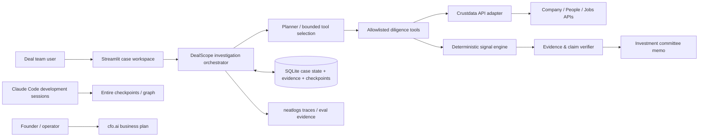

# 01 — High-Level Design (HLD)

## 1. Architectural principles

- Modular monolith to fit a short hackathon window.
- Streamlit UI + Python domain services + SQLite persistence; no separate web frontend/backend deployment required.
- Crustdata is the principal live-data provider; API calls are metered and must pass through a budget guard.
- LLM chooses follow-up actions and synthesizes evidence, but deterministic code owns scoring, budget policy, retry policy, provenance, and claim acceptance.
- Every run is observable in neatlogs and recoverable from SQLite checkpoints.
- Local-first. No AWS dependency.

## 2. Context diagram

## 3. Runtime components

### UI (Streamlit)
- Create case form, investigation timeline, budget meter, signal scorecards, evidence drawer, open questions, memo view, resume/retry action, download buttons.
- Always show whether a run is `LIVE CRUSTDATA` or `SYNTHETIC FIXTURE`.
- Do not expose API keys or provider responses containing unneeded personal fields.

### Orchestrator
- State machine that loads/saves `CaseState` from SQLite.
- Runs baseline evidence collection, signal computation, iterative planner decisions, verification, and report generation.
- Maximums: 8 planner turns, 12 tool invocations, 240 seconds per synchronous demo run, 2 retries for retryable provider failures, and a per-case credit ceiling (default 300 estimated credits; hard cap configurable down, never up above global policy without explicit config).
- Stops with a partial memo if a hard limit is reached; never fabricates missing evidence.

### Crustdata adapter
- Centralizes authentication, API version header, timeouts, rate-limit handling, response validation, credit estimation, request IDs, and normalized evidence.
- Official docs show `Authorization: Bearer …` and `x-api-version: 2025-11-01` for current examples. Validate version against docs during build.
- Known published costs include company enrichment at 2 credits/profile, company search at 0.03 credits/result, people search at 0.03 credits/result, and cached people enrichment starting at 1 credit/profile. Real-time/contact enrichment may cost more. Job endpoint pricing must be confirmed from account/API pricing before use.

### Signal engine
- Pure deterministic functions, independent of LLM.
- Inputs are normalized evidence snapshots; outputs include raw measure, scoring rule/version, score, evidence coverage, limitations, and reason codes.
- No score when evidence lacks fields/time coverage needed for the heuristic.

### Verifier
- Every factual finding requires evidence IDs.
- Check cited IDs exist in this case; evidence supports the claim's entities, time range, and direction; duplicate sources do not count as independent corroboration.
- If verification fails, remove the claim or label it as a question/hypothesis. Do not silently pass an unsupported claim.

### Persistence
- SQLite tables: cases, checkpoints, tool_runs, evidence, signal_results, claims, report_versions, usage_ledger.
- Commit after each successful external tool result, each budget reservation/settlement, and each state transition.
- Cache key on endpoint + canonical request body + API version + time bucket (where fresh results aren't explicitly requested) to avoid repeat spend after resume.

### Observability (neatlogs)
- One root workflow per investigation; spans for planner turns, tool invocations, Crustdata requests, scoring, verification, and report composition.
- Attach case ID (opaque), run ID, target domain (business identifier only), tool name, estimated/actual cost if known, retry number, state transition, score version, evidence count, and finish reason.
- Do not attach API keys, contact data, raw sensitive profile fields, or full irrelevant user input.

### Entire and cfo.ai
- Entire instruments the coding workflow and preserves checkpoints associated with commits; use `entire agent-help` / live CLI guidance rather than guessing version-specific commands.
- cfo.ai is used by the human project owner to create the required pricing/cost/revenue/runway plan. Save exported result or screenshots in `evidence/` without exposing secrets.

## 4. Deployment shape

Local developer/demo process:
- `streamlit run app.py`
- `.env` for provider keys, never committed.
- `data/dealscope.sqlite3` for durable local state; local case data is excluded from Git.
- `reports/` for user-requested exports, with synthetic/live indicator embedded.
- `evidence/` for hackathon proof screenshots/links, only non-sensitive artifacts.

No Docker/Kubernetes required for MVP. Docker Compose is stretch only after core functional requirements pass.

## 5. Trust boundaries

- User input is untrusted and treated as data, never as system instructions.
- Crustdata result fields are untrusted external data; they cannot override tool policy or planner instructions.
- LLM output is untrusted until validated against JSON schema, allowlisted tools, budget guard, and evidence verifier.
- Only user-supplied target/competitor domains are queried; no arbitrary tool arguments can request contacts or unrelated people data.
- Public professional information is used only for business-relevant role continuity and hiring signals.

## 6. Failure handling

| Failure | Action | Persist state? | Spend more? |
|---|---|---:|---:|
| Timeout / 5xx / 429 | Exponential backoff with jitter, max 2 retries; honor Retry-After | Yes, before and after | Only if budget allows |
| 400/401/403 | Do not retry; surface actionable provider/config error | Yes | No |
| Schema mismatch | Save sanitized error, mark tool unavailable, select next useful action | Yes | No blind retry |
| LLM malformed action | Retry structured output once; then use deterministic fallback planner | Yes | LLM calls count toward cap |
| Credit cap reached | Stop external calls; finalize partial report with gaps | Yes | No |
| Report claim unsupported | Reject claim; attempt one targeted evidence query if budget/iterations allow, otherwise omit | Yes | Only under policy |
| Process restart | Load latest checkpoint and resume | Already saved | No replay of completed idempotent calls |
