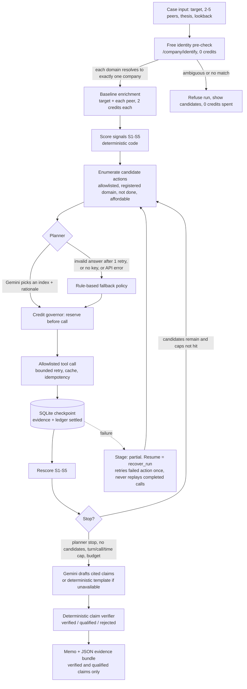

# DealScope: project walkthrough

This document explains what DealScope does, how its agent works on a single case, which design decisions we made and what they cost, what went wrong during the build, and how each partner product (neatlogs, Entire, cfo.ai) changed the project. Every number below is taken from a file in this repository; the source path is given next to it. Where something is an assumption, an estimate or not evidenced, it is labelled as such.

Hackathon window: 10-12 October 2026. All dates and times in the evidence are 2026-10-11 unless stated (IST, per `IMPLEMENTATION_LOG.md`).

---

## 1. Summary

DealScope is an evidence-led, outside-in organizational diligence agent for private-equity, growth-equity and corporate-development deal teams (`docs/00-product-and-scope.md`). A deal team enters a target company domain, two to five peer domains and a deal thesis. DealScope pulls public company, people-history and job-posting data from Crustdata, scores five organizational signals with deterministic code, decides which extra data is worth buying, and produces a memo in which every finding cites evidence and has passed a deterministic verifier. The output is a sourced list of questions to validate before signing.

What it deliberately is not: an investment recommendation, a valuation tool, a legal opinion, or an attrition calculator. Public profiles are a sample, not a census, so DealScope never states an attrition rate, never alleges causes or misconduct from job moves, and treats missing data as "not enough data" rather than as reassurance (`README.md`, `docs/04-signal-catalog.md`).

The agent is bounded and stateful. A language model (Gemini) may choose the next action only from a short list of legal candidates that Python has already checked against an allowlist and the credit budget; if the model is unavailable or answers badly, a rule-based policy chooses instead. Every tool result is checkpointed to SQLite so a failed run can be resumed without repeating paid calls.

**Result of the live tests (all figures from `IMPLEMENTATION_LOG.md` and `evidence/neatlogs/`).** We ran four paid live cases against real Crustdata data (plus one fully cached re-run) with a real Gemini planner. Retool (`case-8ddc70b2b4de`) used 9.18 credits and scored risk 22.2 with 92.5% coverage. Airtable (`case-289f654e60f5`) used 12.21 credits, scored risk 42.7 (Watch), coverage 92.5%, evidence confidence 90, and its regenerated memo had 14 claims, 13 verified and 1 qualified, 0 rejected. A first Notion attempt using `notion.so` spent credits and returned no usable evidence because the domain is ambiguous in Crustdata; that failure led to a free identity pre-check. The corrected Notion run (`notion.com`, `case-d60a330a199c`) used 4.82 credits, scored risk 32 (Watch), coverage 92%, confidence 87. Total real Crustdata spend recorded was 36.21 of 200 credits. In the live runs whose verification results are recorded (Retool, Airtable, the cached Notion re-run) the verifier rejected nothing from the published memo; in the controlled baseline-versus-improved experiment the model's drafts also contained no unsupported claims, so we cannot claim the verifier removed bad claims in live data (see section 5.1). These are small-sample demonstrations on a handful of public companies, not validation of the signals as predictors of anything.

---

## 2. How the agent works, step by step

### 2.1 The loop at a glance

Sources: `src/dealscope/agent/orchestrator.py` (loop, stop reasons, finalization, resume), `src/dealscope/agent/planner.py` (candidates, fallback, LLM contract), `src/dealscope/providers/crustdata.py` (`identify_company`), `README.md` (flowchart and limits). Per run the defaults are at most 8 planner turns, 12 provider tool calls and 240 seconds (`.env.example`, `README.md`).

How it is served: a FastAPI server (`src/dealscope/api/server.py`, started with `uvicorn dealscope.api.server:app --port 8000`, which also serves the built `frontend/dist`) runs each investigation in a background thread, and the React + TypeScript UI polls `GET /api/cases/{id}` for progress. Plain-language view models for the UI are in `src/dealscope/api/views.py`. The earlier Streamlit UI was removed in favour of this frontend; the README quickstart reflects the new setup.

### 2.2 One case, step by step

**1. Inputs.** Target domain, 2-5 peer domains, a deal thesis, a lookback window (default 12 months) and a mode (`synthetic` fixture or `live`). Domains are normalized and validated at the boundary; the target cannot be its own peer (`docs/02-lld.md` section 2). Synthetic runs show a `SYNTHETIC DEMO DATA` banner and use a separate simulated ledger pool so they never consume the real Crustdata allowance (`IMPLEMENTATION_LOG.md`, Decisions).

**2. Free identity check.** Before any metered call, every domain is resolved with Crustdata's free `/company/identify` endpoint. A domain is accepted only if exactly one exact match has that primary domain (and at most three candidates came back). Otherwise the run is refused and the candidates are shown (`identify_company` in `src/dealscope/providers/crustdata.py`). This exists because of a real failure, described in section 4.

**3. Baseline enrichment.** The target and each peer are enriched once with `/company/enrich` (2 credits per company, confirmed on our account, `evidence/crustdata/pricing-20261011T140747Z.json`). Crustdata exposes no engineering-growth scalar, so engineering growth is derived from `headcount.by_function_timeseries.CURRENT_FUNCTION.Engineering` (`IMPLEMENTATION_LOG.md`, Phase A and the smoke test). Provider growth figures that are implausible for an operating company are dropped before scoring and listed in the memo as data-quality flags (section 3, row on the data-quality guard).

**4. Score the five signals.** `analysis/signals.py` computes S1-S5 with fixed weights and thresholds. In plain words:

| Signal | Weight | What it asks | Plain-language reading |
|---|---:|---|---|
| S1 Technical-function trajectory | 30% | Is engineering headcount growing more slowly than total headcount or than peers? | Engineering shrinking or flat while the company grows is worth a question. One percentage alone never produces a top score. |
| S2 Critical-role continuity | 25% | Do the returned profiles show several senior technical people whose employment at the target ended in the window? | Counts distinct people with a dated, completed interval. Not an attrition rate. Needs at least 3 eligible profiles or it is flagged low coverage. |
| S3 Capability coverage / senior bench proxy | 15% | For thesis-critical capabilities (platform, security, data/ML, reliability), do we still observe current technical leaders? | A "publicly observable leadership coverage proxy". "No profile found" means no data, not "no capability". |
| S4 Critical-role hiring pressure | 20% | Are critical technical roles open in clusters, reposted or long-open relative to size and peers? | Few or no postings is "unavailable", never "no hiring problem". |
| S5 Competitor talent movement | 10% | Did identified senior technical alumni join the listed competitors? | Corroborating evidence only, with no claim that anyone took IP or advantage. |

Weights and the rules above are in `docs/04-signal-catalog.md` and `SIGNAL_WEIGHTS` / `THRESHOLDS` in `src/dealscope/analysis/signals.py`. They are heuristics for prioritizing diligence questions and are labelled as unvalidated.

**Risk, coverage and confidence are three separate numbers.** This is the most important modelling choice.
- *Risk* (0-100) is the weighted average of the signals that could be scored. Display bands are 0-24 Low signal, 25-49 Watch, 50-69 Elevated, 70+ High signal. It means signal strength, not probability of deal failure.
- *Coverage* is the share of total signal weight that could actually be assessed. A signal marked low coverage counts for half its weight. Below 60% coverage the composite risk is withheld and the memo says INSUFFICIENT EVIDENCE; 60-79% is "provisional"; 80% or more is "coverage threshold met" (explicitly not "validated").
- *Evidence confidence* is computed from field completeness (30 points), recency (20), independent corroboration (20), peer comparability (15) and identity resolution (15), per `docs/04-signal-catalog.md`.
Missing data lowers coverage and confidence; it never lowers risk. Low coverage is therefore never displayed as low risk (`build_scorecard` in `src/dealscope/analysis/signals.py`).

**5. Candidate actions.** After scoring, deterministic code lists what could legally happen next: a people search for past senior technical employees, a follow-up for current technical leadership (only if departures or undated histories were found), a broader senior-IC search (only if most returned histories lack dates), and a jobs search. Each candidate carries an estimated credit cost, and anything that exceeds the remaining per-case budget is filtered out and logged (`candidate_actions` in `agent/planner.py`, `_candidates` in `agent/orchestrator.py`).

**6. The planner picks.** The planner sends Gemini a compact snapshot (signal states, observations such as "engineering trails total headcount", completed actions, remaining turns and credits, and the numbered candidates) and asks for a candidate index with a rationale, or -1 to stop. An invalid answer gets one corrective retry; after that, or with no API key, or on a model error, the rule-based policy decides. The model cannot invent tools, domains or arguments, and raw model arguments never reach HTTP (`Planner.choose`, `PLANNER_SYSTEM` in `agent/planner.py`). Each decision records who made it (`llm` or `deterministic_fallback`) and why.

**7. The allowlisted tool runs through the credit governor.** `ToolExecutor` checks argument schema and registered domains, then idempotency (completed and unknown-outcome calls are not replayed), then the response cache, then asks the governor to reserve credits. The reservation is persisted before the HTTP request is sent. The call is made with bounded retry (at most 2 retries on 429/5xx/timeouts), and afterwards the reservation is settled against the actual cost from the `X-Credits-Used` header. If the price is unknown, the call is blocked (`UNKNOWN_PRICE_FAIL_CLOSED`). The model has no way to change a price or a cap (`agent/tools.py` and `budget/governor.py` docstrings).

**8. Checkpoint and rescore.** The normalized evidence and the settled ledger row are written to SQLite and a checkpoint is saved after each tool result; signals are then recomputed and score changes are logged (`_record`, `_rescore` in `agent/orchestrator.py`).

**9. Stop.** The loop ends when the planner chooses stop, no candidate remains, the turn/tool-call/time cap is reached, or no candidate is affordable. Failed actions leave the case in stage `partial` with a note such as `no_candidates_with_1_failed_actions` (`_investigate`, `_finalize`).

**10. Draft, verify, render.** Gemini drafts claims from an evidence index (claim types: observation, interpretation, hypothesis, question); deterministic template claims are merged in; and `verification/claims.py` decides what is published. The verifier needs no model. It rejects a material claim that cites no evidence or unknown evidence IDs, mismatched entities, attrition-rate language, causal or misconduct language, valuation language, numbers or dates not present in the cited records, and direction-of-change contradictions. It qualifies (accepts with a label) single-source interpretations and continuity claims that lack an alternative explanation. Only verified and qualified claims reach the memo; if the model is unavailable the memo is built from deterministic claims only (`_finalize`).

### 2.3 A real case: notion.com

The notion.com live case (`case-d60a330a199c`, `IMPLEMENTATION_LOG.md`, 21:50 IST entry) went like this:
1. Identity: the earlier attempt with `notion.so` (peers `coda.io`, `airtable.com`, `clickup.com`) was refused by the new pre-check when verified in the browser: 23 matches of unrelated small companies, suggested `notion.com`, 0 credits spent. The run below used `notion.com` with the same peers.
2. Baseline enrichment of four companies (three peers served from cache), then scoring. The peers' engineering growth came back as +304% to +500% (Airtable, ClickUp), which is a provider data discontinuity, not a real hiring surge. This had produced an absurd peer-range finding.
3. The data-quality guard now drops such values and lists them as flags in the memo's data-coverage section.
4. The run completed in 4 planner turns with 36 evidence records and 4.82 Crustdata credits actual: risk 32 (Watch), coverage 92%, confidence 87, neatlogs trace `b3875a81576975a4536e4bf132c8c7bb`.
5. A third run (`case-fedaa94215ba`, same inputs, fully cached, 0 credits) had Gemini (gemini-3.1-flash-lite) choose all three planner actions and produced a 12-claim memo with 0 rejected; trace `4e64b2898a114a65b3de4608de851bfe`.

Why 4.82 credits and not about 12: the notion.com enrichment cost 2, the jobs search 25 results x 0.03 = 0.75, and the two people searches 1.38 and 0.69, which adds to 4.82. The three peers came from the same-day response cache at 0 credits (cost breakdown confirmed by the project owner; the log records only the total). This is also why 4.82 is not a typical full-audit cost.

### 2.4 Scenario A versus B: the adaptive branch

Two synthetic fixtures (`fixtures/scenario_a.json`, `fixtures/scenario_b.json`) share the same companies but differ in the target's data:

| | Scenario A | Scenario B |
|---|---|---|
| Target total headcount growth (6m / 12m) | +11% / +18% | +10% / +17% |
| Target engineering growth (6m / 12m) | -4% / -2% | +12% / +20% |
| Engineering vs total | engineering trails total | no divergence |
| First action chosen | `search_jobs`: "Engineering growth trails total headcount; check whether critical roles are open." | `search_people`: "No engineering-vs-total divergence observed; test role continuity directly." |
| Outcome (deterministic planner, `evidence/neatlogs/baseline-vs-improved-20261011T144412Z.json` / `...20261012T102646Z.json`) | plan: search_jobs, search_people, search_people, stop; 7 tool calls; risk 54.5 (Elevated), coverage 87.5%, S1 scored 81 | plan: three people searches, then search_jobs, then stop; 8 tool calls; risk 14.2 (Low signal), coverage 92.5% |

The test `test_t02_adaptive_branch_differs_between_scenarios` in `tests/test_orchestrator.py` asserts that the first action and its stated reason differ between the two scenarios, and that scenario B's undated profile histories trigger a coverage-broadening senior-IC search that scenario A never needs. This is the "not a fixed sequence" requirement from `docs/00-product-and-scope.md`.

Note on provenance: the first scenario-B run was invalid because of a budget-pool bug (section 4, item 16); the B figures here and in section 5.1 come from the re-run on 2026-10-12. Low signal here means the synthetic scenario B shows no divergence; it demonstrates the machinery and is not a finding about a real company.

---

## 3. Key design decisions and tradeoffs

| Decision | Why | Cost / tradeoff |
|---|---|---|
| The LLM chooses among deterministic candidates; it never writes tool arguments | Keeps untrusted model output away from HTTP and spending; every action is allowlisted, domain-checked and budgeted before the model sees it (`agent/planner.py`) | The agent cannot be creative: it cannot invent a query the code did not enumerate. Flexibility is limited to ordering, stopping and the rationale text. |
| Deterministic scoring and verifier, no LLM in either | Scores are reproducible and explainable; a model cannot "grade its own homework" (`docs/04-signal-catalog.md`, `verification/claims.py`) | Rules are coarse. Regex-style checks for attrition, causal and valuation language will both miss subtle phrasing and sometimes reject acceptable text. Thresholds are unvalidated heuristics. |
| Rule-based fallback planner and template memo | Runs completed when Gemini failed (503/504, 429, daily quota); the investigation never depends on the model being up (`deterministic_choice`, `deterministic_claims`) | When fallback fires the narrative is plainer. The first Retool run lost its narrative and one planner turn to fallback (`IMPLEMENTATION_LOG.md`). |
| Credit policy scaled to the real balance: total 200, 40-credit global reserve never spent, 40-credit per-case cap, people search capped at 25 results | The account had 200 credits, not the 5,000 the spec assumed (`.env.example`, `IMPLEMENTATION_LOG.md`). Person search costs about 0.23 per result with history filtered and returned, so 25 results is about 5.75 credits | Per-case ceiling and 25-result cap limit how much history a case can see, which lowers S2/S3 coverage on large companies. Spendable pool is 160 credits, not 200. |
| Free identity pre-check before any metered call | A paid enrichment on an ambiguous domain returned junk and cost credits (section 4) | One extra free request per domain; strict "exactly one exact match" can refuse a legitimate but crowded domain, so the user must pick a clearer one. |
| Data-quality guard on provider growth values: drop values above 60% (1m), 100% (3m and 6m), 250% (12m) or 500% (24m), for headcount of 20 or more (`analysis/data_quality.py`) | Live data had +304% to +500% engineering growth from provider discontinuities that produced absurd findings | Thresholds are deliberately loose, so moderate discontinuities still pass; a genuinely explosive but real growth episode could be dropped. Dropped values become memo flags rather than silent edits. |
| Caching and idempotency keys; resume without replay | Resume must not double-spend. Keys hash case, provider, endpoint, canonical body, API version and mode (`docs/02-lld.md` section 5). Unknown-outcome calls are never replayed automatically | Cached results can be stale (retrieval date is shown); an explicit resume retries a failed action once only. |
| Gemini free tier and model switching | Owner declined billing. Quota was 20 requests/day per model family, so the build switched among gemini-3.8-flash, gemini-3.6-flash and gemini-3.1-flash-lite (`IMPLEMENTATION_LOG.md`) | Different models in different runs make cross-run LLM comparisons weak; the baseline-vs-improved experiment used a single model (gemini-3.1-flash-lite) for that reason. |
| SQLite modular monolith behind a FastAPI API, with a React + TypeScript UI | Local-first, no cloud dependency, durable at every tool-result boundary (`docs/01-hld.md`). The API (`src/dealscope/api/server.py`) runs investigations in background threads and the UI polls for progress; plain-language view models are built in `src/dealscope/api/views.py`. State lives in SQLite, so a server restart loses nothing and a partial case can be resumed. The original design used Streamlit, which was replaced because users could not read raw internals | No concurrency or multi-user story; not production architecture. Background threads in one process, no job queue. |
| No attrition rates, no causal or misconduct claims, no valuation or buy/pass advice | Public profiles are a sample; job moves do not prove cause; the product is an early screen (`README.md`, `docs/00-product-and-scope.md`) | The memo cannot give the single headline number deal teams may expect; output is questions and signals. |
| Synthetic fixtures for evals and failure injection | Experiments cost 0 Crustdata credits and are repeatable; a fixture banner prevents confusion with real data | Fixture companies are authored by us, so results demonstrate the machinery, not real-world accuracy. |

---

## 4. What went wrong and what we fixed

Chronological, from `IMPLEMENTATION_LOG.md` unless noted.

1. **Person-search price was wrong in the spec.** The spec pack said 0.03 credits per result. Reading the current Crustdata docs showed about 0.23 (0.03 base, plus 0.1 for the experience filter and 0.1 for experience returned). The governor was updated before any live call. The jobs endpoint stayed disabled until its price was confirmed on the account.
2. **Budget was 200 credits, not 5,000.** The owner reported the real balance; the policy was rescaled through configuration only (`.env.example`).
3. **Free pricing check and smoke test.** `GET /account/endpoints` confirmed company enrich 2.0, person search 0.03 plus 0.1/0.1, job search 0.03 with no premiums (`evidence/crustdata/pricing-20261011T140747Z.json`). A single `retool.com` enrichment charged exactly 2 credits (200.0 to 198.0, `evidence/crustdata/smoke-enrich-20261011T141124Z.json`). That script bypassed the tool-layer cache, so the live case re-enriched retool.com for another 2 credits.
4. **`gemini-2.5-flash` returned 404** for a new key. The default model was changed.
5. **Gemini rejected `maxItems` in structured output** with 400 INVALID_ARGUMENT. `gemini_schema()` now inlines references and drops unsupported keywords; pydantic still enforces bounds when parsing (`providers/llm.py`).
6. **Transient 503/504 from Gemini.** One retry with backoff and a 60 s request timeout. The first Retool run still fell back to the deterministic planner after two 504s.
7. **Free-tier daily quota exhausted.** Twenty requests per day per model family, and 503/504 retries count against it. The owner declined billing. Models were switched as noted in section 3.
8. **Per-minute 429s versus daily 429s.** Added an advised-delay retry (waits up to 40 s when Gemini says how long) and fail-fast on daily-quota errors (`_retry_delay` in `providers/llm.py`). The first Airtable investigation's memo drafting hit the per-minute limit and fell back to deterministic findings; it was regenerated after the fix (`evidence/neatlogs/successful-run.md`).
9. **Resume bug (found by a neatlogs trace).** The first failure-recovery attempt cleared the failed baseline enrichment but never re-ran it, so the case reached `complete` without any target data. The trace of the resume run showed `recover_run`, scoring and verification but no `tool.enrich_company` span (`Screenshot 2026-10-11 213854.png`, `213913.png`, superseded traces `5366ba566b2a5941e47dcae66d9d9fb9` and `f748214a3279fa2fe4f4dd545144d5e1`). Fix: pending baseline actions run on resume, and the test now asserts recovery.
10. **Lookback-window bug.** The S2 departure observation in the memo counted employment intervals outside the lookback window (2021-2026), disagreeing with the S2 score. It now uses the same window as the score.
11. **neatlogs Input/Output columns were empty.** The root span now records short input/output summaries (`set_io` in `observability/tracing.py`).
12. **neatlogs ingest returned 503** for some span batches during the first live run, so the Retool trace `af87b76d2681d7727d184d8aec363d39` is not visible in the dashboard (`evidence/neatlogs/successful-run.md`). The Airtable run replaced it as the primary live proof.
13. **Entire's `prepare-commit-msg` hook blocked commits from the agent session.** See section 5.2.
14. **`notion.so` ambiguity cost credits.** Run 1 (`case-1177e8f2bcd0`) spent 8 credits and returned no usable evidence: the target lookup returned three unrelated records at 2 credits each (6 credits), the `coda.io` enrichment cost 2, and `airtable.com` and `clickup.com` came from cache at 0. All signals were "not scored" and the UI honestly showed INSUFFICIENT EVIDENCE. (`IMPLEMENTATION_LOG.md` records only the 6 for the target; the 8 total is the figure used in its running spend, and the breakdown above was confirmed by the project owner.) Fix: the free `/company/identify` pre-check (FR-01), verified in the browser, where `notion.so` is flagged with 23 matches and suggested `notion.com` at 0 credits.
15. **Provider data discontinuities.** Peer engineering growth of +304% to +500% produced an absurd peer-range finding. Fix: `analysis/data_quality.py` and memo data-quality flags; growth figures are rounded to 0.1.
16. **Scenario-B evaluation was invalid, caused by a budget-pool bug (found while writing this walkthrough).** Simulated (synthetic) credit spend from earlier demo runs had accumulated against the live, account-wide spend cap, so some tool calls in the first scenario-B baseline-versus-improved run were blocked with `GLOBAL_SPENDABLE_BUDGET_EXCEEDED`. That run's numbers (coverage 47.5% and 30.0%, 5 and 1 tool calls) were therefore meaningless. Fix: the global cap now applies to the live pool only, while synthetic runs keep their per-case cap. Scenario B was re-run on 2026-10-12 (`evidence/neatlogs/baseline-vs-improved-20261012T102646Z.json`); the invalid run is kept at `evidence/neatlogs/superseded/baseline-vs-improved-20261011T144435Z.json`. Two of the neatlogs screenshots (`213426.png`, `213450.png`) show those invalid first B runs.

Test suite at the last log entry: 265 tests passed, ruff clean (`IMPLEMENTATION_LOG.md`).

---

## 5. How each partner product improved the project

### 5.1 neatlogs (runtime observability)

**What is traced.** `observability/tracing.py` wraps neatlogs behind a facade that is a no-op without an API key and redacts attributes (no keys, tokens, emails or phone fields; strings capped at 300 characters). Spans: `investigation_workflow` (root), `plan_next_action` (agent), one `tool.<name>` per provider call, `score_signals` (with score-change events), `synthesize_findings` and the Gemini call beneath it (when the client is wrapped), `verify_claims` (guardrail), `render_memo`, and `recover_run` on resume. Attributes include case id, mode, iteration, who decided each action, candidate counts, coverage, risk, score version and finish reason (`agent/orchestrator.py`).

**What the traces showed us.**
- *The resume bug.* A trace with `recover_run` followed immediately by scoring and no enrichment span made the missing re-run visible (section 4, item 9). The corrected pair is `Screenshot 2026-10-11 213824.png` (first run, stage partial, 19 steps, one enrichment failed) and `213802.png` (resume: `recover_run`, `tool.enrich_company`, scoring, memo; output "complete (no_candidates); risk 54; coverage 88%; tool calls 8; verified claims 9").
- *The Gemini failure and fallback pattern.* In the live Airtable investigation (`213732.png`) there are LLM errors in the planner and synthesis spans, with some planner calls succeeding on retry. In the superseded evaluation attempt (`213609.png`, `213651.png`) several `gemini-3.6-flash` calls show "Execution Failed", yet the workflow still completes through the deterministic fallback, verifies and renders the memo. This is the behaviour we designed for; the traces are the evidence that it actually happened.
- *Measured LLM cost.* neatlogs shows token counts and cost per call. Planner calls on gemini-3.6-flash are about $0.003 each at roughly 1,600-1,700 tokens (`213732.png`). Synthesis calls range from $0.0015 on gemini-3.1-flash-lite at 2,175 tokens (`213426.png`) to $0.02 on gemini-3.6-flash at 11,146 tokens for the live Airtable memo regeneration (`213710.png`), which made no new tool calls. The cfo.ai plan had assumed $0.05 per audit. (Costs are neatlogs list-price figures read from screenshots; actual billing on the free tier was $0, per `evidence/cfo-ai/assumptions.md`.)
- *The Input/Output improvement.* Early traces had blank Input/Output columns; after the fix each root span reads, for example, "complete (planner_stop); risk insufficient evidence; coverage 30%; tool calls 1; verified claims 10" (`213426.png`, the invalid first B run, which is why its numbers look odd).

**Baseline versus improved experiment** (`evidence/neatlogs/baseline-vs-improved.md`). Same fixtures, same deterministic planner, same model (gemini-3.1-flash-lite); the only difference is the memo prompt. Baseline: a loose "summarize the risks" prompt. Improved: strict evidence schema, observation/interpretation separation, mandatory alternative explanations, prohibited-claim rules, plus deterministic findings. n = 1 run per variant per scenario.

| Scenario | Variant | Draft claims | Draft rejected | Draft verified / qualified | Published claims | Trace id |
|---|---|---:|---:|---|---:|---|
| A | baseline | 4 | 0 | 2 / 2 | 4 | `28fe5ba00882582eb3d298795274dff9` |
| A | improved | 6 | 0 | 5 / 1 | 15 | `4475d391852dad1707054011b73a3d11` |
| B | baseline | 3 | 0 | 1 / 2 | 3 | `39ee81cc2045fe5f160e428bb24943cd` |
| B | improved | 6 | 0 | 6 / 0 | 17 | `e63bac7e90a7d4de175c300f139a82a2` |

**Honest reading.** There was no reduction in unsupported claims: both variants had zero rejected claims on both fixtures, because the model only sees the evidence index with IDs in either case. The improved variant produced more claims that pass verification outright (5 versus 2 on A; 6 versus 1 on B), fewer claims that needed a caveat (1 versus 2 on A; 0 versus 2 on B), explicit diligence questions and a fuller memo once deterministic findings are merged (15 versus 4 published on A; 17 versus 3 on B). Tool calls and runtime were essentially the same (7 versus 7 on A; 8 versus 8 on B, about 15-16 s on B). The verifier's rejection behaviour is shown separately by unit tests (for example `test_unsupported_llm_claims_are_rejected_from_memo`: a fabricated ID, a "40% left" claim, an IP-leak claim and a valuation claim are all rejected), not by this experiment. Two earlier attempts are kept under `evidence/neatlogs/superseded/` and not used: a first evaluation on gemini-3.6-flash that hit 503/429 and gave neither variant an LLM draft, and the invalid first scenario-B run (section 4, item 16).

**Trace ids.**

| Purpose | Trace id | Source |
|---|---|---|
| Live Airtable investigation (primary proof) | `d3a8f383b6cf980bfc51fcdc436478cd` | `evidence/neatlogs/successful-run.md` |
| Live Airtable memo regeneration (Gemini drafting, 0 new tool calls) | `81dd213dbdbc546acd906ecf44f66478` | same |
| Live Retool (not visible in dashboard; ingest 503) | `af87b76d2681d7727d184d8aec363d39` | same |
| Failure recovery, first run (partial after 503 x 3) | `9e30eca63a3634b9a6f1b8ffe29770c9` | `evidence/neatlogs/failure-recovery.md` |
| Failure recovery, resume (complete, no duplicate calls) | `3665d83293f0eab47ddb542835ff4622` | same |
| Superseded resume pair (exposed the resume bug) | `5366ba566b2a5941e47dcae66d9d9fb9`, `f748214a3279fa2fe4f4dd545144d5e1` | same |
| Baseline A / B | `28fe5ba00882582eb3d298795274dff9` / `39ee81cc2045fe5f160e428bb24943cd` (B re-run 2026-10-12) | `evidence/neatlogs/baseline-vs-improved.md` |
| Improved A / B | `4475d391852dad1707054011b73a3d11` / `e63bac7e90a7d4de175c300f139a82a2` | same |
| Invalid first scenario-B pair (budget-pool bug, superseded) | `d0e4b0e650a5dd7fe21fc9b8a244decf` / `526d3215aee19b3f355e610e2ae47c19` | `evidence/neatlogs/superseded/baseline-vs-improved-20261011T144435Z.json` |
| Live notion.com run | `b3875a81576975a4536e4bf132c8c7bb` | `IMPLEMENTATION_LOG.md` |
| Live notion.com, cached rerun with Gemini planner | `4e64b2898a114a65b3de4608de851bfe` | same |

Screenshots (13, `evidence/neatlogs/screenshots/`):

| File | What it shows |
|---|---|
| `Screenshot 2026-10-11 213426.png` | Synthetic run (the invalid first scenario-B improved run, see section 4 item 16) with input/output summaries; gemini-3.1-flash-lite synthesis span, 2,175 tokens, $0.0015. Valid evidence of the span structure and cost, not of the B results |
| `213450.png`, `213516.png`, `213542.png` | Complete synthetic runs (the invalid first B baseline, A improved, A baseline): enrichment, planner turns, scoring, searches, synthesis, `verify_claims` guardrail, `render_memo` |
| `213609.png`, `213651.png` | Resilience: several gemini-3.6-flash calls "Execution Failed", workflow still completes (superseded evaluation attempt) |
| `213710.png` | Live Airtable memo regeneration via `recover_run`, gemini-3.6-flash, 11,146 tokens, $0.02, no new tool calls |
| `213732.png` | Live Airtable investigation with real tool latencies, LLM errors and successful retries |
| `213802.png`, `213824.png` | Failure-recovery pair: resume with `recover_run` and retried enrichment, and the first partial run |
| `213854.png`, `213913.png` | Earlier resume pair that exposed the resume bug (superseded) |
| `213929.png` | neatlogs delivery probe (`dealscope-probe`) |

### 5.2 Entire (coding-agent checkpoints)

**What it did.** Entire CLI 0.11.4 was installed with the official script, then the owner ran `entire login` and `entire enable --agent claude-code` (`SUBMISSION_EVIDENCE.md`, `evidence/entire/README.md`). It links each git commit to the Claude Code session that produced it through an `Entire-Checkpoint:` trailer, and pushes checkpoint refs to the remote.

**Evidence of the link.**
- Commit `70400f8` ("Record traced proof runs, resume fix, eval results") carries `Entire-Checkpoint: 01M4NTHZJBFDKJ80R5FCA3CDZS` (`evidence/entire/README.md`, `SUBMISSION_EVIDENCE.md`).
- Commit `75783c2` ("Live browser test fixes: free identity pre-check, provider data-quality guard") carries `Entire-Checkpoint: 01M4NW7H2CWZJSACHHWFK2QWS9` (`SUBMISSION_EVIDENCE.md`, `evidence/entire/README.md`).
- A transcript export of the build session is saved at `evidence/entire/transcript-khasim007q-DealScope-9d2490e9-f40.md` (session `9d2490e9-f406-446d-8f45-6979c161ecee`, agent Claude Code, model claude-opus-5-5, created 2026-10-11T02:47:10Z, 1 checkpoint, 300,286 output tokens).
- `entire doctor` reported metadata branches, git hooks and Claude Code hook config OK with no stuck sessions. `SUBMISSION_EVIDENCE.md` records 5 checkpoint refs on the remote; the log's earlier entry recorded 4, which is consistent with more being pushed later.
- Not captured: an Entire screenshot and an `entire-graph` output (both marked TODO in `SUBMISSION_EVIDENCE.md`).

**How it made the multi-agent build auditable.** The build used one lead model (Opus) and Sonnet sub-agents. The transcript records the delegation calls with their target model, including: Crustdata API research, persistence plus credit governor, deterministic signal engine, claim verifier plus memo, Crustdata client plus fixture source (each at high effort), and README/evidence scaffolding (medium effort) (six Sonnet delegations in the transcript, `evidence/entire/transcript-khasim007q-DealScope-9d2490e9-f40.md`). A reviewer can read which module was delegated, what the sub-agent reported back, and how the lead integrated it, then jump from the matching commit to the same session through its checkpoint. The sub-agent reports in the transcript are labelled as model output, not user instructions.

**The interactive-hook problem and its resolution.** The `prepare-commit-msg` hook asks "Link this commit to session context? [Y]es / [n]o / [a]lways". From the non-interactive agent shell, that prompt waits forever. Commit `a86ab8d` was completed only after the stuck hook process was stopped, so it has no checkpoint trailer; `entire doctor` looked healthy, which hid the cause. The resolution recorded in `evidence/entire/README.md`: answer `a` once in an interactive terminal so the choice is remembered. Commits `70400f8` and `75783c2` do carry trailers.

### 5.3 cfo.ai (business plan)

**The plan** (shared model: https://cfo.ai/s/LuzFz_Xw5PkfkLJJ, horizon October 2026 to September 2027; exports in `evidence/cfo-ai/`; assumptions in `evidence/cfo-ai/dealscope-assumptions.md` and `assumptions.md`). All of it is assumption: DealScope has no customers, no revenue and no signed pilots (stated in the investor summary PDF and the assumptions brief).

**Pricing options compared.** Per audit at $750, $1,500 or $3,000; an annual deal-team plan at $24,000 including 24 audits with $1,000 per extra audit; a hybrid of a $6,000 workspace fee plus $1,000 per audit. No unlimited plan until data-cost variance and support load are measured.

**Unit economics.** Delivery cost of $94.65 per audit = 1.5 hours of human QA at $60 ($90), plus $2.60 of Crustdata (26 credits x $0.10 per credit, the per-credit price being an editable input because it is not published), plus $0.05 of LLM inference, plus $2 tooling. Card processing at 3% and support sit below gross profit. Fixed costs are $750 per month ($150 hosting, $100 software, $500 sales and marketing) plus $500 per month compliance from month 6. Founder salary is a $0 placeholder.

**Three scenarios** (`evidence/cfo-ai/DealScope-investor-summary.pdf`):

| | Conservative | Base | Growth |
|---|---:|---:|---:|
| Earned revenue (12 months) | $30,000 | $270,000 | $390,000 |
| Audits delivered | 40 | 180 | 390 |
| Gross margin | 87.20% | 93.69% | 90.54% |
| Contribution margin | 82.20% | 90.02% | 86.79% |
| Peak modeled funding need | $1,500 | $0 | $0 |

Conservative assumes 2 customers x 2 audits per month at $750 with data and model costs 50% higher and a two-month delay to first revenue. Base assumes 5 customers x 3 audits per month at $1,500. Growth assumes a linear ramp to 15 customer-equivalents x 4 audits per month on annual pricing; its $555,000 of collections includes $165,000 of deferred service obligations that are not earned revenue. **Runway is left blank** because opening cash was not supplied, and the model deliberately did not invent a number; a zero funding need does not mean cash is available. The margins are dominated by the assumed $90 of human review per audit, so they say little about the data and model cost.

**How real run data fed back.**
- *Crustdata credits per audit.* The plan used 26 credits (a pre-run estimate: 4 enrichments, 2-3 people searches of 25 results, jobs search). Measured actuals from the two traced live cases were 9.18 (Retool) and 12.21 (Airtable); the corrected Notion run recorded 4.82, low only because three peers came from cache, so it is not a full-audit cost. At the same $0.10 per credit assumption, 9.18-12.21 credits is $0.92-$1.22 rather than $2.60, which would lower delivery cost by roughly $1.38-$1.68 per audit (our arithmetic), under 2% of the $94.65 total. The measured figures are not yet written into the cfo.ai export, which still carries 26 credits, so the modeled data cost is conservative (`SUBMISSION_EVIDENCE.md`, `evidence/cfo-ai/assumptions.md`). The investor summary's statement that 200 credits cover about 7 audits at 26 credits or 5 at the 40-credit cap uses the estimate, not the measured numbers.
- *LLM cost.* The plan assumed $0.05 per audit (about 6 model calls, roughly 40k input plus 5k output tokens). neatlogs showed about $0.003 per planner call and $0.0015-$0.02 per synthesis call, in total of the order of a few cents per audit by our reading of the screenshots. Free-tier runs were billed $0. The $0.05 input is therefore about right in order of magnitude and could be replaced by a measured figure.
- *What this changes.* Little of the margin story, because human review dominates. It does change the data-credit capacity of the 200-credit allocation, and it shows that the per-audit price of data is the least certain input (it depends on the per-credit price, which we did not obtain).

---

## 6. Limitations and next steps

**Limitations (honest).**
- Small samples. Four live cases and two synthetic scenarios, n = 1 per experiment variant. Nothing here validates the signals as predictors of deal outcomes; thresholds are heuristics.
- Public-profile coverage is a sample, not a census. S2, S3 and S5 depend on how many profiles Crustdata returns and whether they carry dated employment intervals; the 25-result cap deepens this.
- Provider data discontinuities exist and only the loosest guard is in place (section 3).
- The baseline-versus-improved experiment showed no difference in unsupported claims; it showed improvement in verified-claim count only. The improved-variant memo is larger partly because deterministic findings are merged in, which is not purely a prompt effect.
- The deployed LLM runs were on a free tier with a daily quota, so several runs used fallback paths; model identity varied across runs.
- The Retool trace is missing from the neatlogs dashboard because of an ingest outage.
- There are no customers, no revenue and no external validation; the cfo.ai plan is a set of hypotheses. Runway is blank because cash is unknown.
- Pending items listed as TODO in `SUBMISSION_EVIDENCE.md` when this was written: demo video, public `#neatHack` post URL, quote-post submission URL, confirmation of the final deadline, an Entire screenshot and an `entire-graph`.

**Next steps (suggested, not committed work).**
- Re-export the cfo.ai plan with measured credits and measured LLM cost and a real per-credit price.
- Run a few more live cases with a paid or higher-quota Gemini key to compare LLM versus rule-based planning with enough runs to say something.
- Add a human review step to the UI (the business plan already assumes 1.5 hours of QA per memo).
- Run design-partner pilots with agreed accuracy and usefulness criteria, as the investor summary proposes.
- Replace the regex-style verifier heuristics with additional deterministic checks and a held-out set of adversarial claims.

---

## 7. Evidence index

| Topic | File |
|---|---|
| Scope, design, agent protocol | `README.md`, `docs/00-product-and-scope.md`, `docs/01-hld.md`, `docs/02-lld.md`, `docs/04-signal-catalog.md`, `docs/06-crustdata-credit-budget.md`, `docs/07-hackathon-partner-requirements.md`, `docs/10-crustdata-api-reference.md` |
| Full build history, decisions, failures, fixes | `IMPLEMENTATION_LOG.md` |
| Submission checklist and evidence register | `SUBMISSION_EVIDENCE.md` |
| neatlogs: live run, failure recovery, baseline vs improved | `evidence/neatlogs/successful-run.md`, `evidence/neatlogs/failure-recovery.md`, `evidence/neatlogs/baseline-vs-improved.md` |
| neatlogs raw results | `evidence/neatlogs/live-run-20261011T141632Z.json`, `live-run-20261011T143949Z.json`, `failure-recovery-20261011T143846Z.json`, `baseline-vs-improved-20261011T144412Z.json`, `baseline-vs-improved-20261012T102646Z.json` (scenario B re-run), `superseded/baseline-vs-improved-20261011T144325Z.json`, `superseded/baseline-vs-improved-20261011T144435Z.json` |
| neatlogs screenshots (13) | `evidence/neatlogs/screenshots/` |
| Crustdata pricing and smoke test | `evidence/crustdata/pricing-20261011T140747Z.json`, `evidence/crustdata/smoke-enrich-20261011T141124Z.json` |
| Entire | `evidence/entire/README.md`, `evidence/entire/transcript-khasim007q-DealScope-9d2490e9-f40.md` |
| cfo.ai | `evidence/cfo-ai/README.md`, `assumptions.md`, `dealscope-assumptions.md`, `DealScope-investor-summary.pdf`, `exported-plan.pdf.xlsx`, `DealScope - Assumptions.xlsx`, `DealScope - Business summary.xlsx`, `DealScope - Financial projection.xlsx`, `DealScope - Pricing and sensitivity.xlsx` (the four workbooks have an em dash in their file names) |
| Demo script | `docs/demo-script.md` |
| API and view models for the React UI | `src/dealscope/api/server.py`, `src/dealscope/api/views.py`, `frontend/src/api/types.ts` |
| Source for the claims in section 2 | `src/dealscope/agent/planner.py`, `agent/orchestrator.py`, `agent/tools.py`, `agent/synthesis.py`, `budget/governor.py`, `verification/claims.py`, `analysis/signals.py`, `analysis/data_quality.py`, `providers/crustdata.py`, `providers/llm.py`, `observability/tracing.py` |
| Tests referenced | `tests/test_orchestrator.py` (adaptive branch, resume), `tests/test_claims.py`, `tests/test_data_quality.py` |
